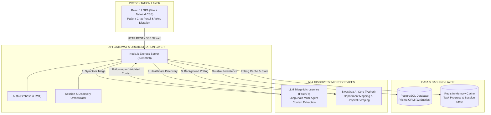

# MedPath - Guided Healthcare & AI Clinical Navigation Platform

<div align="center">
  
</div>

MedPath is an AI-powered, location-aware guided healthcare platform designed to simplify clinical triage, streamline symptom analysis, and match patients with local clinical departments and healthcare providers.

---

## 🌐 Live Deployments & Cloud Environments

| Component / Service | Description / Role | Platform | Live URL / Endpoint | Status |
| :--- | :--- | :--- | :--- | :--- |
| **Frontend Web App** | Patient Portal, Dictation & Chat UI | Vercel | [medpath-v1-ak.vercel.app](https://medpath-v1-ak.vercel.app/) |  |
| **Node.js Express Backend API** | Central Orchestrator, Auth & Database Gateway | Render | [medpath-server.onrender.com](https://medpath-server.onrender.com/) |  |
| **LLM Microservice** | **Phase 1**: Real-time Symptom Triage & Context Extraction | Render | [medpath-microservices.onrender.com](https://medpath-microservices.onrender.com/) |  |
| **Swasthya AI Core** | **Phase 2**: Full Clinical Research, Scraping & Hospital Discovery | Render | [swasthya-ai-core.onrender.com](https://swasthya-ai-core.onrender.com/) |  |

---

## 🌟 Key Features

- 🩺 **Two-Phase Clinical Assessment**:
  1. **Phase 1 (Triage Chat & Context Extraction)**: Real-time streaming symptom analysis via the **LLM Microservice** (`medpath-microservices.onrender.com`).
  2. **Phase 2 (Clinical Research & Discovery)**: Once patient context is complete, the **Swasthya AI Core** (`swasthya-ai-core.onrender.com`) triggers background clinical department scraping, hospital discovery, and ranking.
- ⚡ **Optimistic & Flicker-Free UI**: Smooth Server-Sent Events (SSE) streaming with permanent message mounting and interactive status indicators.
- 📍 **Geospatial Hospital Discovery**: Real-time matching of identified symptoms against local clinical departments, distance, and estimated care costs.
- 🎙️ **Voice Dictation**: Hands-free symptom input using integrated Web Speech API dictation.
- 🛡️ **HIPAA-Inspired Security & Authentication**: Firebase Authentication paired with JWT validation and role-based access.
- ⭐️ **Patient Reviews & Ratings System**: Verified patient experience reviews with detailed ratings across cleanliness, wait times, and staff responsiveness.
- 🎨 **Modern Glassmorphic Design System**: Light and dark mode support built with Tailwind CSS, custom design tokens, and fluid Framer Motion animations.

---

## 🏗️ High-Level System Architecture

MedPath operates as an enterprise-grade, distributed microservice architecture designed for real-time clinical triage, stateful multi-turn symptom analysis, and asynchronous healthcare discovery.

### 1. High-Level Architecture Diagram



---

### 2. Component Overview

| Component | Responsibility | Technology / Integration |
| :--- | :--- | :--- |
| **Client** | Captures patient symptoms via text or voice, captures GPS coordinates, and renders triage and hospital recommendations. | React 19, Vite 8, Tailwind CSS v4, Framer Motion, Web Speech API, Geolocation API |
| **Backend Server** | Validates authentication, orchestrates session lifecycles, relays SSE streams, and coordinates AI and discovery tasks. | Node.js (>=18.0), Express.js, Firebase Admin SDK, Winston Logger |
| **AI / Agent Layer** | Extracts clinical signals from conversation history, checks symptom sufficiency, and generates empathetic follow-up questions. | Python 3.10+, FastAPI (`/llm`), LangChain Multi-Agent Engine, Pydantic schemas |
| **LLM Service** | Delivers language understanding and text generation for symptom extraction and follow-up clinical questions. | Groq (`llama-3.3-70b-versatile`), Mistral AI (`mistral-small-latest`), Google Gemini API |
| **Cache / Context Store** | Caches high-frequency discovery polling progress, multi-turn chat history, and conversation metadata without database load. | Redis 7 (in-memory key-value cache with configurable TTLs) |
| **Database** | Persists relational user accounts, consultation records, clinical contexts, hospital snapshots, and patient reviews. | PostgreSQL 15 accessed via Prisma ORM (12 relational data models) |
| **Healthcare Integration** | Maps patient symptoms to clinical departments and initiates regional healthcare search jobs. | Swasthya AI Core REST API (`POST /api/v1/discovery/search`) with retry client |
| **Hospital Discovery** | Scrapes regional medical registries, computes suitability and trust scores, and generates tiered care cost estimates. | Swasthya AI Core scraping engine with automated fallback to local PostgreSQL hospital directory |
| **Deployment** | Hosts distributed microservices and executes automated continuous integration and deployment pipelines. | Vercel (Frontend), Render (API Gateway, LLM Service, Swasthya AI Core), Docker & Docker Compose, GitHub Actions |

---

### 3. High-Level Request Flow

The primary patient consultation journey follows an 8-step lifecycle:

1. **User Query Intake**: The patient inputs symptoms through text or hands-free voice dictation on the React web app, with optional GPS geolocation capture.
2. **Gateway Verification & Session Handling**: The client sends the query with a Firebase Bearer JWT to the Node.js Express API, where middleware authenticates the token, enforces rate limits, and persists the user message to PostgreSQL.
3. **Clinical Triage & Context Extraction**: The backend forwards the consultation turn to the Python FastAPI microservice, where a LangChain multi-agent pipeline extracts symptoms, duration, severity, and care intent.
4. **Sufficiency Validation & Clarifying Loop**: If core clinical signals are incomplete, the agent returns an empathetic clarifying question streamed back to the client via Server-Sent Events (SSE); the patient responds until all required clinical signals are gathered.
5. **Asynchronous Healthcare Discovery Dispatch**: Once patient context is marked complete, the backend submits the clinical payload to the Swasthya AI Core discovery endpoint, obtaining an asynchronous `taskId`.
6. **Zero-DB Out-of-Band Polling**: A Node.js background poller queries Swasthya AI Core every 2 seconds and writes progress directly to Redis (`task:{taskId}`), enabling the client to poll discovery progress in sub-milliseconds without querying PostgreSQL.
7. **Atomic Persistence & Fallback Handling**: Upon search completion (or triggering a fallback search against local database hospital records if external services time out), an atomic Prisma transaction persists `RecommendationSnapshot` records and marks the conversation completed.
8. **Recommendation Presentation & Continuous Consultation**: The client mounts interactive hospital recommendation cards with department matches, trust scores, estimated costs, and navigation directions, allowing the user to continue the conversation or submit verified reviews.

---

### 4. Key Architectural Boundaries & Design Decisions

- **Decoupled Gateway & Intelligence**: Express.js isolates high-speed HTTP/SSE communication from Python LangChain AI processing, preventing heavy language model processing from blocking gateway throughput.
- **Zero-PostgreSQL Polling Overhead**: Discovery progress is polled every 2 seconds during active searches; reading exclusively from Redis (`task:{taskId}`) prevents database connection exhaustion.
- **Resilience with Graceful Degradation**: External Swasthya HTTP requests use 3-tier exponential backoff (`1s → 2s → 4s`). If the external service is unavailable or times out, the backend automatically falls back to the local PostgreSQL hospital registry.
- **HIPAA-Inspired Privacy Redaction**: Sensitive clinical signals (symptoms, diagnoses, medical history) are filtered through a recursive sanitization layer before request or response payloads are recorded in log files.

---

## 📁 Repository Structure

```text
MedPath/
├── client/                     # React 19 + Vite Frontend Application
│   ├── src/
│   │   ├── components/         # Reusable UI Primitives & Chat Components
│   │   │   ├── chat/           # Streaming Bubble, Thinking Cards, Discovery Card
│   │   │   ├── location/       # Location Permission Modal & Manual Form
│   │   │   └── ui/             # Card, Button, Input, Badge, ProgressBar
│   │   ├── context/            # Auth, Conversation, Location & Theme Contexts
│   │   ├── layouts/            # Main Responsive App Layout & Sidebar
│   │   ├── pages/              # ChatPage, Dashboard, HospitalDetails, Reviews
│   │   └── services/           # Axios API Client & Conversation SSE Stream
│   ├── index.css               # Design Tokens & Custom CSS Utilities
│   └── vite.config.js
│
├── server/                     # Node.js + Express Backend API
│   ├── prisma/                 # Prisma Database Schema & Migrations
│   ├── src/
│   │   ├── config/             # Environment Configurations & Firebase Admin
│   │   ├── modules/            # Auth, AI, Conversations, Reviews Modules
│   │   ├── routes/             # Express API Route Handlers
│   │   └── services/           # Discovery Polling & Swasthya Integration Service
│   └── server.js
│
├── llm/                        # LLM Context Extraction & Triage Microservice (Python FastAPI)
│   ├── app/
│   │   ├── agents.py           # Multi-Agent Clinical Triage Engine (LangChain + Mistral/Groq)
│   │   ├── config.py           # Pydantic BaseSettings & Environment Config
│   │   ├── memory.py           # Redis Multi-Turn Conversation Memory Manager
│   │   ├── prompts/            # Triage & Symptom Parsing Prompt Templates
│   │   └── schemas.py          # Pydantic Input/Output Validation Models
│   └── main.py                 # FastAPI App Bootstrap & Endpoint Routing
│
├── DESIGN_SYSTEM.md            # Frontend UI Design System Specifications
├── LOCATION.md                 # Location Engine & Geolocation Documentation
└── REVIEW_SYSTEM.md            # Patient Reviews Architecture Documentation
```

---

## 🚀 Getting Started

### Prerequisites

Ensure you have the following installed on your machine:
- **Node.js**: `v18.0.0` or higher
- **npm**: `v9.0.0` or higher
- **Python**: `3.10` or higher
- **Git**

---

### 🛠️ Installation & Local Setup

#### 1. Clone the Repository
```bash
git clone https://github.com/Amankumar140/MedPath.git
cd MedPath
```

---

#### 2. Setup LLM Context Extraction Microservice (Python FastAPI)
```bash
cd llm
python -m venv venv

# On Windows:
venv\Scripts\activate
# On macOS/Linux:
# source venv/bin/activate

pip install -r requirements.txt
```

Create a `.env` file in the `llm/` directory:
```env
MISTRAL_API_KEY=your_mistral_api_key_here
PORT=8000
LOG_LEVEL=INFO
```

Start the FastAPI service:
```bash
python -m uvicorn app.main:app --reload --port 8000
```

---

#### 3. Setup Server (Node.js API)
In a new terminal window:
```bash
cd server
npm install
```

Create a `.env` file in the `server/` directory:
```env
PORT=3000
DATABASE_URL="file:./dev.db" # or PostgreSQL connection string
SWASTHYA_API_URL="https://swasthya-ai-core.onrender.com"
PYTHON_MICROSERVICE_URL="https://medpath-microservices.onrender.com" # or http://localhost:8000
JWT_SECRET="your_jwt_secret_key"
NODE_ENV="development"
```

Initialize Database & Start Dev Server:
```bash
npm run db:generate
npm run db:migrate:dev
npm run dev
```

---

#### 4. Setup Client (React Frontend)
In a third terminal window:
```bash
cd client
npm install
```

Create a `.env` file in the `client/` directory:
```env
VITE_API_URL="http://localhost:3000/api/v1"
```

Start the Frontend Dev Server:
```bash
npm run dev
```

Open your browser and navigate to `http://localhost:5173`.

---

## 🧪 Testing & Verification

### Running Frontend Linter
```bash
cd client
npm run lint
```

### Running LLM Context Microservice Tests
```bash
cd llm
pytest
```

---

## 📋 API Reference Summary

| Method | Endpoint | Description |
| :--- | :--- | :--- |
| `POST` | `/api/v1/auth/session` | Authenticate user & sync profile |
| `GET` | `/api/v1/conversations` | List user consultation history |
| `POST` | `/api/v1/conversations` | Start a new consultation session |
| `POST` | `/api/v1/conversations/:id/messages` | Stream user message via SSE relay |
| `GET` | `/api/v1/conversations/:id/discovery/progress` | Poll background Swasthya AI department search |
| `GET` | `/api/v1/hospitals` | Search & filter local hospitals by location/symptoms |
| `POST` | `/api/v1/reviews` | Submit patient experience review |

---

## ⚠️ Medical Disclaimer

MedPath is an AI-assisted guidance tool designed for informational and navigation purposes only. It is **not** a substitute for professional medical advice, diagnosis, or emergency care. In case of a medical emergency, please immediately contact your local emergency services or visit the nearest emergency room.

---

## 📄 License

Distributed under the MIT License. See `LICENSE` for more information.
